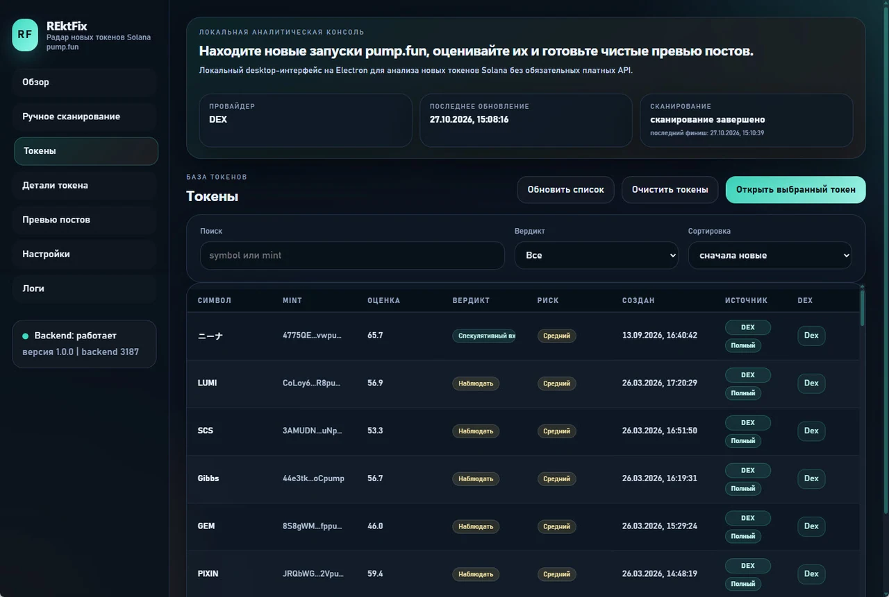

# RektFix Desktop - анализ токенов Pump.Fun

Автор проекта - **Евгений Толмачев**. [Профиль GitHub](https://github.com/EvgenyET) · [Проект в портфолио](https://evgeny-dev.pro/project.html?id=RektFix_old)

Настольный анализатор токенов Pump.Fun. Сканирование Solana, проверка признаков риска, сохранение результатов в SQLite и подготовка текста публикаций.

## Задача проекта

Ранний настольный этап проекта RektFix, посвящённый анализу отдельного токена. В нём отработаны сбор и обогащение данных, объяснимые признаки риска и локальная история. Поздняя веб-версия переносит основной фокус на профиль создателя и совокупность его запусков.

## Мой вклад

Разработал Electron-интерфейс и локальный Fastify API, вынес сканирование в отдельный рабочий процесс. Организовал провайдеры данных, обогащение токенов, расчёт оценок и сохранение истории в SQLite. Подготовил карточки с причинами предупреждений, настройки сканера и генератор предпросмотра публикаций.

## Интерфейс

**Сводка настольного сканера**

**Таблица результатов сканирования**

## Как работает приложение

RektFix Desktop объединяет поиск новых токенов Pump.Fun и разбор их показателей в настольном интерфейсе. Пользователь задаёт период сканирования, получает список кандидатов и открывает карточку с данными о ликвидности, держателях и создателе. Приложение дополняет сведения из Solana RPC и внешних источников, применяет набор правил оценки и сохраняет анализ в SQLite. Из результата можно сформировать предпросмотр публикации для Telegram или X.

## Возможности

- Сканирование токенов Pump.Fun за выбранный промежуток времени с ограничением количества результатов.
- Обогащение данных через Solana RPC и дополнительные источники, включая DexScreener и Rugcheck.
- Оценка концентрации держателей, ликвидности, прав mint/freeze и других признаков риска.
- Сохранение анализов и истории сканирований в SQLite, поиск результатов в настольном интерфейсе.
- Подготовка предпросмотра текста публикаций для Telegram и X.

## Техническое устройство

### Настольное приложение

Electron запускает окно и локальный backend. Preload обеспечивает связь интерфейса с приложением, renderer содержит dashboard, сканирование, карточки токенов, настройки и журнал.

### API и фоновое сканирование

Fastify обслуживает локальные маршруты. Сканирование вынесено в рабочий процесс, а сервисы управляют проходами по временным окнам, повторной обработкой и обогащением данных.

### Источники и оценка

Провайдеры отделены от бизнес-логики. Модули анализа собирают данные о создателе и токене, scoreEngine сводит частные метрики и предупреждения в итоговую оценку.

### Хранение и материалы публикации

База хранит результаты анализа и историю. Отдельный модуль строит предпросмотр публикаций из сохранённых данных.

## Технологии

| Технология | Роль в проекте |
| --- | --- |
| Electron | Настольный интерфейс и взаимодействие с локальным backend. |
| Node.js / Fastify | Локальный API, управление сканированием и сервисы анализа. |
| SQLite | Хранение анализов токенов, настроек и истории сканирований. |
| @solana/web3.js | Чтение транзакций и сведений об аккаунтах через Solana RPC. |
| JavaScript | Интерфейс, адаптеры источников и правила расчёта оценок. |

## Состояние показанной версии

- Оценка риска основана на эвристиках и доступных данных источников.
- Публикации формируются как предпросмотр, отправка в Telegram и X не реализована.
- Модуль outcomeTracker генерирует демонстрационные исходы, а не измеряет фактическую динамику цены после сигнала.

## Демонстрация

На странице портфолио доступны описание, галерея и видеодемонстрация проекта. [Открыть RektFix Desktop - анализ токенов Pump.Fun](https://evgeny-dev.pro/project.html?id=RektFix_old).
