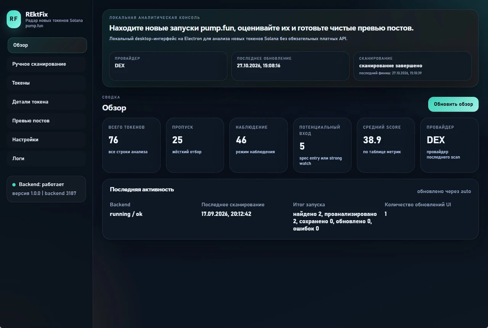

# RektFix Desktop - анализ токенов Pump.Fun

**Автор проекта:** [Евгений Толмачев](https://github.com/EvgenyET) · [Страница проекта в портфолио](https://evgeny-dev.pro/project.html?id=RektFix_old)

Настольный прототип для исследования новых токенов Pump.Fun: сбор данных Solana, эвристическая оценка рисков, локальная история и предпросмотр публикаций.

## Мой вклад

В ранней настольной версии собрал в одном окне поиск токенов Pump.Fun и проверку признаков риска. Связал сканер Solana с внешними источниками и локальной базой SQLite, чтобы результаты проверок можно было открыть повторно.

## Интерфейс

**Сводка настольного сканера**

**Таблица результатов сканирования**

## Как это работает

Приложение объединяет Electron-интерфейс и локальный Fastify API. Сканер получает кандидатов из источников данных, дополняет сведения о токенах и создателях, рассчитывает оценку по набору правил и сохраняет результаты в SQLite. В карточке токена доступны метрики, причины предупреждений и заготовки публикаций для Telegram и X.

## Возможности

- Сканирование токенов Pump.Fun за выбранный промежуток времени с ограничением количества результатов.
- Обогащение данных через Solana RPC и дополнительные источники, включая DexScreener и Rugcheck.
- Оценка концентрации держателей, ликвидности, прав mint/freeze и других признаков риска.
- Сохранение анализов и истории сканирований в SQLite, поиск результатов в настольном интерфейсе.
- Подготовка предпросмотра текста публикаций для Telegram и X.

## Технологии

JavaScript, Electron, Node.js, Fastify, SQLite, Solana RPC.
